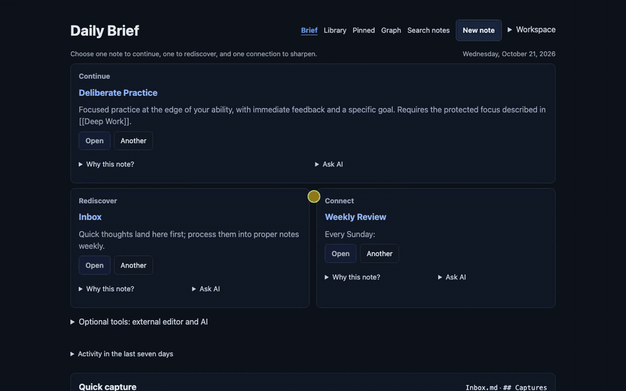
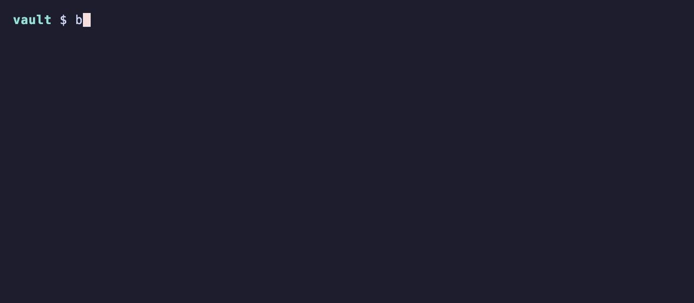

# Brain Notes (`bn`)

[](https://github.com/sglavoie/brainnotes/actions/workflows/ci.yml)
[](LICENSE)
[](go.mod)

Brain Notes is a Go CLI and browser workspace for a plain-Markdown notes vault.
Use it alongside an editor such as VS Code or Neovim, or run `bn serve` to
browse and edit your notes in the browser. Your notes stay ordinary Markdown
files with YAML frontmatter; there is no database to export from.



<details>
<summary>The same vault from the terminal</summary>



</details>

Both recordings are generated by `just demo` from the sample vault in
[`scripts/demo/vault`](scripts/demo/vault), so they show the current build.

## What you can do

- **Capture and create:** send a thought to your inbox or create a note from a template.
- **Find and connect:** search Library, save views, explore related notes, and follow the link graph.
- **Read and edit:** read rendered Markdown, edit source, manage properties, and pin notes you return to often.
- **Review and recover:** inspect change history, preview bulk edits, and undo journaled changes.

One query language spans all three surfaces it can be typed into — `bn find -q`,
the `/library` query bar, and the `/graph` filter — with the same syntax, the
same semantics, and one execution path, so a saved view means exactly the same
thing at the terminal and in the browser.

## Install

### Prebuilt binaries

Download the archive for your platform from the
[latest release](https://github.com/sglavoie/brainnotes/releases/latest)
(macOS, Linux and Windows, on x86-64 and ARM64), check it against
`checksums.txt`, and put all three binaries (`bn`, `bn-vault-guard`,
`bn-vault-sync`) in the same directory on your `PATH`. They must stay at the
same version, so replace them together.

```sh
tar -xzf brainnotes_<version>_<os>_<arch>.tar.gz
cp brainnotes_<version>_<os>_<arch>/bn* ~/.local/bin/
```

The binaries are not code-signed. On macOS, clear the download quarantine with
`xattr -d com.apple.quarantine ~/.local/bin/bn*` if Gatekeeper refuses to run them.

### From source

Install [Go](https://go.dev/dl/) 1.26.2 or newer and
[just](https://just.systems/man/en/) first. Add your Go install directory to
`PATH` (`$(go env GOBIN)` if set, otherwise `$(go env GOPATH)/bin`) so `bn` is
available in a new shell.

```sh
git clone https://github.com/sglavoie/brainnotes.git
cd brainnotes
just install
bn --version    # the Git revision this build came from
```

## Quick start

```sh
# Mark a directory as a vault root (writes brainnotes.toml there).
bn init /path/to/vault

# Run from inside the vault, or point bn at it explicitly.
export BNOTES_VAULT=/path/to/vault

# Open the browser workspace.
bn serve
```

In the browser, choose **Create your first note** (or **New note**), enter a
title, and select **Create and write**. Add a sentence in the editor and select
**Save**. Open **Library** and search for a word from that sentence to find the
note you just saved. Your note is a Markdown file in the vault; you can also edit
it with your usual text editor.

Capture a thought from the terminal without choosing a filename:

```sh
bn capture "ask [[Bob]] about the migration"
```

### Go further

```sh
# Find every book note that's still 'To Read'.
bn find --category Books --status "To Read"

# Or say it as one query expression: boolean composition, typed property
# comparison, and link-graph operators the flags cannot spell.
bn find -q 'near:[[Deep Work]]<=2 and status:wip and not folder:Archive'

# Save that as a [[views]] block in brainnotes.toml and run it by name.
bn find --view "Active work" --sort -modified

# Pipe to fzf for interactive selection.
bn find --category Books -i

# Revisit the current note through related notes and an inspectable context packet.
bn related Notes/Current.md -i
bn context Notes/Current.md --purpose questions

# Set a property across many notes.
bn find --tag drafts | bn set - status=done
```

## Contributing

Contributions are welcome. Start with [CONTRIBUTING.md](CONTRIBUTING.md), then
the [development guide](docs/development.md) for setup, generated assets,
validation, and browser testing. Please report security problems privately as
described in [SECURITY.md](SECURITY.md).

## Documentation

- [Configuration](docs/configuration.md)
- Command reference:
  - [Finding notes](docs/commands-query.md)
    - [Query expressions (`-q`)](docs/commands-query.md#query-expressions--q)
  - [Saved views](docs/commands-views.md)
  - [Research commands](docs/commands-research.md)
  - [Vault administration and recovery](docs/commands-vault.md)
    - [Consistent external snapshots (`bn checkpoint`)](docs/commands-vault.md#bn-checkpoint--hold-the-vault-still-while-another-tool-copies-it)
  - [Note creation and navigation](docs/commands-notes.md)
  - [Local web server](docs/web-server.md)
    - [Related Notes explorer](docs/web-related-notes.md)
    - [Synthesis workbench](docs/web-synthesis.md)
    - [Health, Daily Fixes, and properties](docs/web-health.md)
  - [Maintenance and bulk edits](docs/commands-maintenance.md)
- [Shell completion and editor integration](docs/integrations.md)
- [Recipes, safety, performance, and migration notes](docs/workflows.md)
- Contributors: `docs/internals/` documents the architecture, locking model, serving modes and capabilities, web write classes, recall boundaries, graph view invariants, and synthesis workbench invariants.

### Read-only replica server

`bn --vault /path/to/replica serve --read-only --state-dir /path/to/activity --no-open`
serves a read-only note browser. Create the activity directory outside the vault first.
The server skips transaction recovery and Git safety initialization, keeps its note
index in memory, and permits only Daily Brief visits and Open/Another actions to
write external activity state. Open navigates to a rendered note in this mode.
Editor, agent, note/config writes and undo are blocked centrally.

Optionally supply `--replica-status-file /path/to/status.json` containing
`{"last_successful_sync":"2026-09-15T12:00:00Z"}`. The browser shows the last sync
and flags it stale after 15 minutes. `/api/ready` returns content-free readiness
and freshness, with stale content still available. Use an authenticated reverse
proxy for remote access; protect every path, including attachments and readiness.
Synchronizing a replica (for example to a Raspberry Pi) is left to your own
deployment tooling; `bn-vault-sync` and `bn-vault-guard` are the building blocks.

### Hosted server

To write a new note in the browser, choose **New note** in the navigation,
enter a title and optional vault-relative folder, then select **Create and write**.
This saves a title-only note and opens the browser editor; use **Save** to store
your writing. Leave the folder blank to use the vault root. **Capture** remains
the quick-thought flow into your configured inbox. Note creation and editing are
available in local and hosted modes, but not on read-only replicas.

`bn --vault /path/to/vault serve --hosted --no-open` serves the vault itself over
the network. It is not a read-only replica with writes re-enabled: document
actions (capture, properties, pins, cockpit fixes, synthesis) stay available,
while every route that would start a process on the serving machine — the editor,
and the `[agent].command` routes behind Ask AI, daily review, and synthesis
generation — is refused, and the pages that would offer those actions say why
instead of pointing at a config file on the wrong machine. Open navigates to the
rendered note, as in read-only mode. Request bodies are bounded at 1 MiB (local
serving keeps 32 MiB), except the few routes whose payload is a whole note, draft,
or file: source preview, save, and create (12 MiB + 32 KiB), synthesis preview
(3 MiB + 32 KiB), and attachment upload (25 MiB) — see
[Serving modes](docs/internals/serving-modes.md). State-changing requests must be same-origin as well as
carry the CSRF token, responses are `private, no-store`, and an attachment whose
type a browser would execute is sandboxed and sent as a download.
`--read-only` and `--hosted` are mutually exclusive. There is still no auth
layer: put an authenticated reverse proxy or tunnel in front of every path.

## License

[MIT](LICENSE). Bundled third-party software is listed in
[THIRD_PARTY_NOTICES.md](THIRD_PARTY_NOTICES.md).
